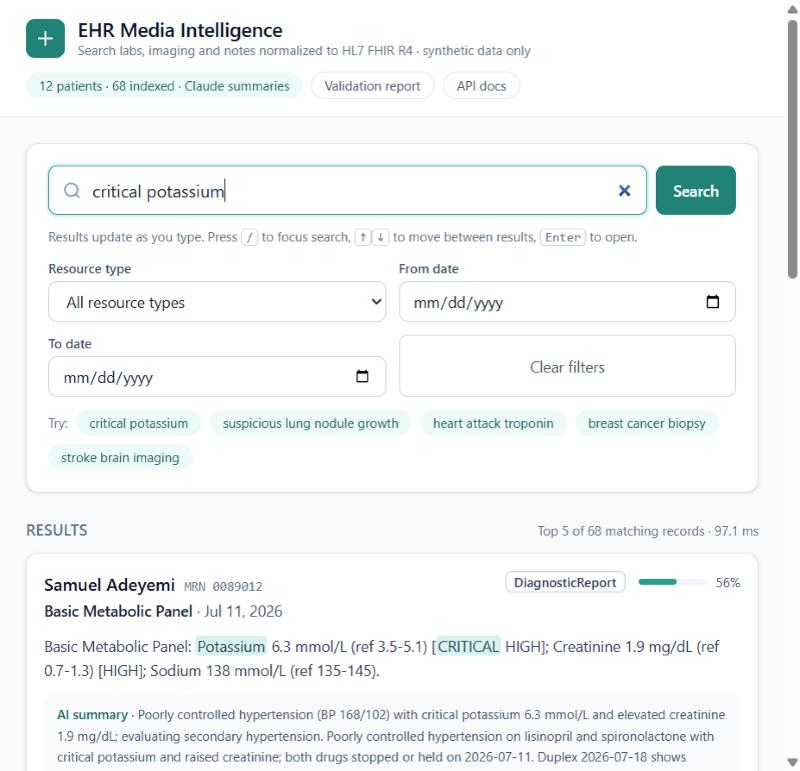
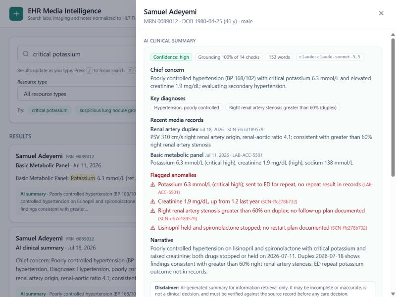

# EHR Media Intelligence Platform

I built a pipeline and web app that take messy, heterogeneous EHR exports (a JSON EHR extract, a CSV of lab results and OCR'd scanned notes), clean them, map them to **HL7 FHIR R4**, generate **AI clinical summaries** with Claude, and let a clinician find the right record in seconds with **semantic search**.

All data in this repository is **synthetic**. I hand-wrote it and then deliberately broke it in realistic ways (see [Sample data](#sample-data)). There is no real patient data anywhere in the repo.




---

## Quick start

Requirements: Python 3.11+ (I developed on 3.14, Windows 11). Node is **not** needed; the compiled Tailwind CSS is committed.

```powershell
python -m venv .venv
.venv\Scripts\Activate.ps1
pip install -r requirements.txt
```

Optional, to use Claude for summaries: copy `.env.example` to `.env` and set `ANTHROPIC_API_KEY`. Without a key, the app automatically uses the offline summarizer.

```powershell
python -m app.pipeline
```

That builds everything: it ingests, cleans, maps to FHIR, validates, stores, summarizes and indexes. The first run downloads `all-MiniLM-L6-v2` (~90 MB).

```powershell
uvicorn app.api.main:app --port 8000
```

Then open <http://127.0.0.1:8000> for the UI and <http://127.0.0.1:8000/docs> for the interactive API docs. If you skip the pipeline step, the API builds the store on first start.

```powershell
pytest
```

That runs all 151 tests, about 40 s. The end-to-end tests use the real embedding model.

Useful pipeline options:

| Command | What it does |
|---|---|
| `python -m app.pipeline --summarizer claude` | Force Claude (falls back to offline per patient if a call fails) |
| `python -m app.pipeline --summarizer rule-based` | Offline, deterministic summaries |
| `python -m app.pipeline --force-summaries` | Ignore the summary cache |
| `python scripts/generate_synthetic_data.py` | Regenerate the raw sample files |
| `npm install` then `npm run build:css` | Only if you change Tailwind classes |

Generated artifacts go to `var/` (git-ignored): `ehr.db` (SQLite), `index/` (FAISS), and `reports/validation_report.{json,md}` and `reports/audit_log.json`. A copy of the validation report is in [docs/sample_validation_report.md](docs/sample_validation_report.md).

---

## Architecture

```
 data/raw/                app/ingestion/            app/fhir/                    app/store.py (SQLite)
 ehr_export.json ─┐       loaders  ──► cleaning ──► mapper ──► validator ──►    patients, records,
 lab_results.csv ─┼──►    (parse)      (normalize,    (R4 resources,   (schema +     bundles, validation,
 scanned_notes.txt┘                    identity,      1 Bundle /       bindings +    summary cache
                                       dedupe, audit) patient)         references)        │
                                                                                          ▼
   frontend/ (Tailwind + vanilla JS)  ◄── app/api (FastAPI) ◄── app/search (MiniLM + FAISS) ◄── app/summarization (Claude
   search · filters · drawer               POST /search …           records + AI summaries          + grounding + cache)
```

`app/pipeline.py` runs the whole chain; `app/api/main.py` serves it.

### Project layout

```
app/
  config.py                 settings from env / .env
  ingestion/  models.py     Pydantic canonical schema + AuditEntry
              loaders.py    JSON / CSV / TXT parsers (no cleaning)
              cleaning.py   pure normalizers (dates, gender, MRN, names, OCR text, labs, doc types)
              pipeline.py   identity resolution, de-duplication, encounter linking
  fhir/       mapper.py     canonical model -> FHIR R4 resources + Bundle
              validator.py  validation + JSON/Markdown report
  summarization/ prompt.py  system prompt + Bundle rendering
              summarizer.py Claude adapter, offline fallback, grounding, cache service
  search/     embedder.py   sentence-transformers wrapper (+ test embedder)
              index.py      FAISS index, chunking, hybrid ranking, filters
  store.py                  SQLite persistence
  pipeline.py               end-to-end build CLI
  api/main.py               FastAPI app
frontend/                   index.html, app.js, styles.css (compiled), src/input.css
scripts/                    synthetic data generator
tests/                      pytest suite
```

---

## How I met each requirement

### Task 1: Ingestion and cleaning

| Requirement | Where / how |
|---|---|
| Two or more input formats | JSON export, CSV labs **and** plain-text OCR notes (`loaders.py`). Column/key aliases (`dob`/`birthDate`/`date_of_birth`, `sex`/`gender`…) are mapped. Bad files are reported, not fatal. |
| Missing fields | Missing record date → filled from the encounter (audited). Missing doc type → inferred from text. Missing gender → filled from another source, else `unknown`. Missing MRN → matched on name + DOB. Empty notes → dropped (audited). |
| Inconsistent dates | 16 formats (`03/14/1958`, `21-Jul-1985`, `March 2, 2026`, `2026/02/10 06:15`, ISO…). Ambiguous `04/05/2026` is read as US and audited, `25/12/2025` is swapped and flagged, and future or pre-1900 dates are cleared and flagged. |
| Duplicates | Repeat patient exports merged; duplicate documents removed by id **or** content hash; duplicate lab rows removed. |
| Conflicting identifiers | Same MRN + different DOB → `identifier_conflict`. Different MRN + same name/DOB (the sample has a transposition typo) → linked as an **alternate** MRN and flagged `possible_duplicate_mrn`. I deliberately do not silently merge, because in a real EHR that goes to HIM review. |
| Canonical demographics | MRN → 7-digit zero-padded; gender → FHIR AdministrativeGender; names → given/family, re-cased (`GONZALEZ, MARIA` → Maria Gonzalez); DOB → ISO date. |
| Validated IR + audit log | Pydantic v2 models (`Patient`, `Encounter`, `ClinicalRecord`, `LabResult`). **Every patient and record carries its own `audit` list** (`field`, `action`, `before`, `after`, `reason`, `source` with the file and line/path). Dataset-level events are kept too, and everything is written to `var/reports/audit_log.json`. |
| ≥ 3 unit-tested edge cases | `tests/test_cleaning.py` + `tests/test_ingestion.py`: 65 tests. |

### Task 2: FHIR R4

* **Resources:** `Patient`, `Encounter`, `DocumentReference` (clinical notes, text as base64 attachment, LOINC note type), `DiagnosticReport` (labs/imaging/pathology/cardiology with v2-0074 category, `conclusion`, `presentedForm`), and `Observation` (one per analyte with LOINC, UCUM `valueQuantity`, reference range and HL7 interpretation `H/L/HH/LL`) linked from `DiagnosticReport.result`.
* **One `collection` Bundle per patient.** Every clinical resource has `subject` → the Patient and `encounter` / `context.encounter` → an Encounter. Records with no source encounter are linked to the encounter covering their date, or to a synthesized same-day ambulatory one, so references are never missing. IDs are deterministic UUIDv5, so re-runs produce identical Bundles.
* **Validation** (`validator.py`) works in three layers:
  1. Each resource and the Bundle envelope go through `fhir.resources` (cardinality, datatypes, primitive formats such as `instant` needing a zone).
  2. **Required terminology bindings**. I found that `fhir.resources` accepts `gender: "M"` because it doesn't check value sets, so I added explicit checks.
  3. Reference integrity and business rules (single Patient, subject/encounter present and resolving), plus data-quality warnings.

  Errors carry the FHIRPath-like location and message. The report is JSON + Markdown and is exposed at `GET /reports/validation`. Result: **12/12 bundles valid, 0 errors, 1 warning** (the flagged duplicate MRN).
* **Storage:** SQLite (`bundles`, `records`, `patients`, `summaries`, `meta`). Bundles are stored verbatim.

> I used the `fhir.resources` **R4B** model set because 8.x defaults to R5 and no longer ships a pure R4 package. Patient, Encounter, DocumentReference, DiagnosticReport, Observation and Bundle are structurally the same in R4 (4.0.1) and R4B (4.3.0), so the output is valid R4 JSON. For example, `Encounter.class` is a single `Coding`, as in R4, not R5's list.

### Task 3: AI summarization

* **Claude Sonnet 5.5** (`claude-sonnet-5-5`, set with `CLAUDE_MODEL`) via the official `anthropic` SDK with **structured output** (`output_config.format` JSON schema), so the response is always parseable. Effort is `low` because this is extraction, not reasoning-heavy. Server-side refusal fallback is enabled.
* **Fields:** chief concern, key diagnoses, recent media records (date, type, finding, **record id**), flagged anomalies (with record id), narrative, plus `confidence`, `disclaimer`, `word_count`, `grounding`, `generator`, `prompt_version`.
* **Prompt engineering** (`prompt.py`): the Bundle is rendered as compact text with record ids, labs folded into their report with `** HIGH **` markers, and newest first. The rules are: only facts in the records, keep the source's uncertainty, quote numbers exactly, cite record ids, stay under 200 words, and make no own recommendations.
* **Quality guards** (`summarizer.py`): after every generation I count words and run a **grounding check**. Every number in a claim must appear in the source, most content words must appear, and every cited record id must exist. If anything fails, I re-prompt **once** with the specific problem. If the summary is still too long, I trim list items. Confidence is computed from these checks rather than self-reported by the model.
* **Cache:** SQLite, keyed by `sha256(patient_id + bundle content hash + prompt version + generator)`. Re-runs make zero API calls, and changing any record or the prompt invalidates exactly the affected patients.
* **Disclaimer** on every summary, shown prominently in the UI.
* **Real output:** I ran Claude Sonnet 5.5 on all 12 patients and reviewed every summary against its source. The summaries are committed in [docs/claude_summaries.json](docs/claude_summaries.json), and the review (per-patient verdicts, and how three runs tightened the prompt and checker from 11 retries to 2) is in [docs/summary_review.md](docs/summary_review.md). Each summary records why its first draft was rejected (`retry_reason`), if it was.
* **Fallback:** if the API fails (no key, rate limit, outage, refusal) that patient gets a deterministic rule-based summary in the same schema. It is **not** cached under the Claude key, so the next run retries Claude.

### Task 4: Semantic search

* `all-MiniLM-L6-v2` embeddings (normalized) of every DocumentReference/DiagnosticReport text **and** every AI summary, in a **FAISS** inner-product index persisted to `var/index/`.
* Long texts are chunked (120 words, 30 overlap), and a record scores as its best chunk.
* **Hybrid ranking:** `0.8 × cosine + 0.2 × keyword overlap`. Pure MiniLM ranked a sodium panel above the *critical potassium* result for "critical potassium". The small lexical term fixes exact clinical terms while "heart attack" still finds the NSTEMI note. Both component scores are returned.
* `POST /search` takes `{"query": "..."}` in the body. Filters are **query parameters**: `resource_type` (repeatable: `DiagnosticReport`, `DocumentReference`, `Patient` = AI summaries), `date_from`, `date_to`, and `top_k` (default 5). Filters apply **before** the top-k cut, so filtered queries never come back short. Invalid ranges return 422.
* **Latency:** ~20 ms per query warm on a laptop CPU for 68 indexed items (56 records + 12 summaries). A test asserts < 2 s end to end with the real model.

### Task 5: Frontend

Vanilla JS + Tailwind CSS (compiled with the Tailwind v4 CLI), served by FastAPI.

* Debounced real-time search (300 ms; in-flight requests are aborted), example queries, and query-term highlighting.
* Result cards show patient name, MRN, record date, a resource-type badge, a relevance bar, the matched snippet and an AI summary snippet.
* The patient drawer (`role="dialog"`) has the full AI summary (confidence, grounding, word count, generator, disclaimer), an identity-review banner, the linked FHIR resources grouped by type with an on-demand **JSON viewer**, validation status, and a Bundle download.
* Filters: resource type dropdown, from/to date pickers, inline validation, and Clear.
* States: skeleton loading with `aria-busy`, a patient overview when idle, an empty state with a one-click "clear filters", and an error state.
* Accessibility and keyboard: labelled controls, `role="search"`, `aria-live` status, cards with descriptive `aria-label`s, <kbd>/</kbd> to focus search, <kbd>↑</kbd>/<kbd>↓</kbd>/<kbd>Home</kbd>/<kbd>End</kbd> between results, <kbd>Enter</kbd> to open, <kbd>Esc</kbd> to close, a focus trap in the drawer with focus returned to the card, and a skip link.
* Responsive: single column with a full-width drawer on phones, and a 3-column patient grid on desktop.

---

## API

| Method | Path | Purpose |
|---|---|---|
| `POST` | `/search?resource_type=&date_from=&date_to=&top_k=` | Ranked matches with `score`, `semantic_score`, `keyword_score` |
| `GET` | `/patients` | Patient list with record counts and flags |
| `GET` | `/patients/{id}` | Canonical patient (incl. audit log), AI summary, linked resources, validation |
| `GET` | `/patients/{id}/summary?refresh=true` | Cached summary, or regenerate |
| `GET` | `/patients/{id}/bundle` | FHIR Bundle (`application/fhir+json`) |
| `GET` | `/patients/{id}/resources/{resource_id}` | One FHIR resource |
| `GET` | `/reports/validation`, `/reports/audit` | Validation report, cleaning audit log |
| `GET` | `/health` | Counts, embedder and last pipeline run stats |
| `POST` | `/admin/rebuild` | Re-run the pipeline |

```powershell
curl.exe -X POST "http://127.0.0.1:8000/search?resource_type=DiagnosticReport&date_from=2026-01-01" -H "Content-Type: application/json" -d '{\"query\": \"suspicious lung nodule\"}'
```

---

## Sample data

There are 12 fictional patients and 56 clean records after processing, from 23 patient mentions, 40 documents and 32 lab rows across the three files. Problems I injected on purpose, and the tests that cover them:

* Dates in many formats, one **ambiguous** (`04/05/2026`), one **impossible future** (`2062`), and one **missing**.
* Gender as `M`, `f`, `1`, `2`, `male`, or blank.
* MRNs as `MRN-0012345`, `12345`, `00-34567`, and `mrn 0045678`.
* The same patient exported twice; the same patient under a **transposed MRN**; a lab row with **no MRN**; a name variant (`Lynda`/`Linda`) under one MRN; a patient who only exists in the labs + notes.
* An exact duplicate document, a duplicate lab row, an empty scanned document, and a document with no type.
* OCR hyphenation across line breaks (`hypo-\nthyroidism`), which I re-join while keeping real hyphens (`ICS-formoterol`).

---

## Testing

`pytest` runs **151 tests**:

| File | Covers |
|---|---|
| `test_cleaning.py` | every normalizer, edge cases (dates, gender, MRN, names, OCR text, labs, doc typing) |
| `test_ingestion.py` | loaders, identity resolution, de-duplication, audit log, encounter linking |
| `test_fhir.py` | resource content, reference integrity, determinism, validator catching bad data, report, store |
| `test_summarizer.py` | schema, disclaimer, 200-word guard, hallucination/number/citation detection, paraphrase false positives, retry, cache, fallback, Claude request shape and error handling (mocked), and the committed real Claude summaries |
| `test_api.py` | search ranking, filters, validation errors, all endpoints, **real-model relevance** and **< 2 s latency** |
| `test_frontend.py` | UI served, labels/ARIA landmarks present, JS wired to the API |

Every commit's own test suite passes on its own.

I also tested the UI by hand in a browser, against the real model and data:

* typing search and highlighting
* resource-type and date filters (results respected both)
* the invalid date-range message
* the empty state and its clear-filters link
* ↓/↑/Enter keyboard navigation
* the drawer: summary, flags, highlighted source record, JSON viewer
* the Esc key and focus return
* the Tab focus trap
* the <kbd>/</kbd> shortcut
* the skeleton loader and `aria-busy`
* the error state
* a 375 px mobile layout with no horizontal overflow
* Swagger docs
* no console errors

---

## Design decisions and tradeoffs

* **Rule-based cleaning, not ML.** It is predictable and auditable; every change is explainable in the audit log, which matters more than cleverness for clinical data.
* **Conservative identity matching.** I link, flag and keep alternate identifiers instead of auto-merging. A false merge in an EHR is far worse than a duplicate.
* **FHIR built as plain dicts, validated after.** What gets stored is exactly what was validated, and building is decoupled from the library's object model.
* **One Bundle per patient, type `collection`, `urn:uuid` references.** These are self-contained and resolvable without a server. A `transaction` Bundle would be the next step for loading into a FHIR server.
* **Flat FAISS index + exact search.** At hundreds of vectors this is sub-millisecond and exact, and it lets filters apply before ranking. At 100k+ records I'd move to IVF/HNSW with pre-filtering or a vector DB.
* **Offline fallback summarizer.** The demo, the tests and outages never depend on an external API, and summaries keep the same schema. It's clearly labelled `rule-based`, so nobody mistakes it for an LLM summary.
* **Tailwind compiled once and committed.** It's production CSS with no Play CDN, and reviewers don't need Node.

See [WRITEUP.md](WRITEUP.md) ([PDF](docs/WRITEUP.pdf)) for the one-page write-up (tradeoffs, improvements, FHIR/clinical research, and AI quality validation). Every claim in it points to a test or file; the per-patient summary review behind it is in [docs/summary_review.md](docs/summary_review.md) (regenerate with `python scripts/review_summaries.py`). Rebuild the PDF with `python scripts/build_writeup_pdf.py`.

## Notes

* This is a demo: there is no authentication, and data stays local. Before anything real it would need auth, audit logging of access, encryption at rest and a BAA-covered LLM deployment.
* The AI summaries are **not** clinical decisions; each one says so.
